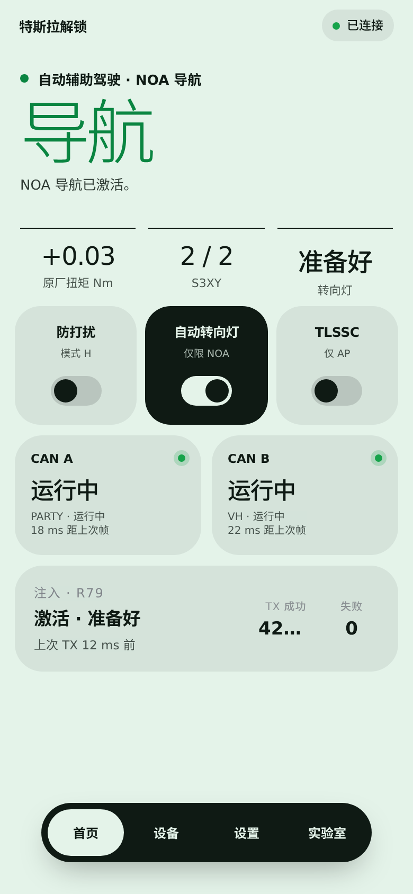
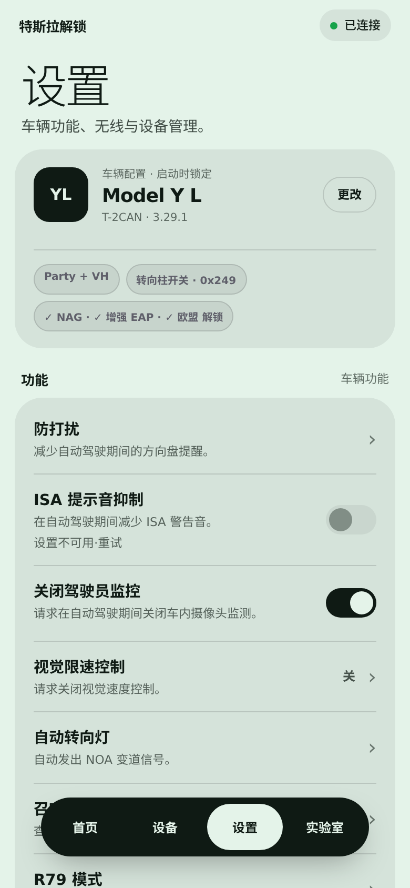
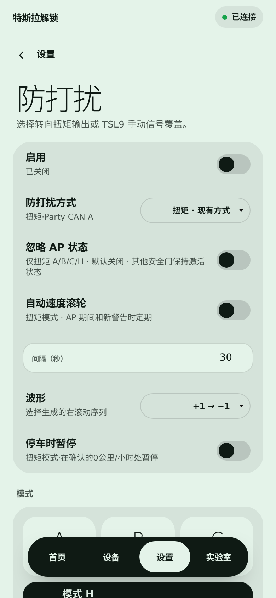
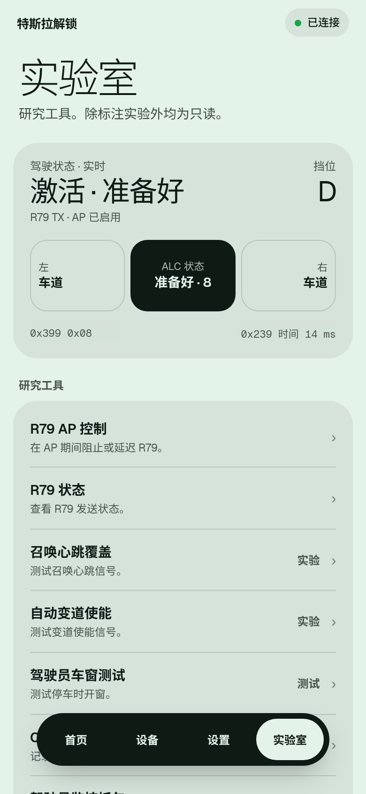

# T2CAN Universal v3.29.1 · 中文 Dashboard

[](https://github.com/bi4nbn/t2can-universal-unlock/actions/workflows/build-release.yml)

> 基于上游 [06066060606060/t2can-universal-unlock](https://github.com/06066060606060/t2can-universal-unlock) v3.29.1 的 fork。
> 本仓库在**不修改 CAN 注入逻辑**的前提下，把网页控制台（Dashboard）完整中文化，并提供 GitHub Actions 自动编译与 Release 发布。

> ⚠️ **研究 / 教育用途**：本项目会直接向特斯拉 CAN 总线注入信号，作者与上游均明确说明**未经过台架/实车验证**。只能在隔离台架或封闭场地研究，**不要用于公共道路**。风险与合规责任由使用者自行承担。

## 中文界面预览

以下截图来自本地离线预览（模拟数据，未连接车辆），用于展示中文 Dashboard 的布局与文案：

| 首页 | 设置 |
| --- | --- |
|  |  |

| 防打扰（NAG） | 实验室（LAB） |
| --- | --- |
|  |  |

> 截图中的车辆状态、扭矩、CAN 计数均为演示数据；不代表真实车辆行为。

## 这个 fork 做了什么

- **Dashboard 中文化**：页面标题、导航、开关、设置项、状态、说明、可见属性全部中文；`<html lang>` 从上游误写的 `ko` 修正为 `zh-CN`。
- **动态文本翻译层**：JS 运行时写入的状态/计数/提示通过页面内嵌中文词典和 `MutationObserver` 翻译；**只改显示，不改任何业务逻辑**。
- **保留技术术语**：`CAN / NAG / TLSSC / R79 / AP / NOA / MUX1 / HO / TX / RX / 0x 帧 ID / HW3 / S3XY / BLE / NVS` 等保留英文，方便对照 CAN 资料；车型名保留 `Model 3 / Model Y`。
- **构建与发布自动化**：新增 GitHub Actions，推送 `v*` tag 时自动用 ESP32 core 3.3.12 编译 OTA 与整片镜像，并创建 GitHub Release。
- **固件逻辑未改**：CAN、NAG、TLSSC、R79、OTA、BLE 等与上游 v3.29.1 保持一致。

## 主要功能（继承上游）

- **防打扰 / NAG Killer**：转向扭矩注入（Mode A/B/C/H）或 TSL9 手势；可选关闭驾驶员监控（`0x3FD` MUX1 bit43）。
- **Advanced EAP / 自动转向灯**：检测到 NOA 变道请求后自动打灯，带延迟、取消与防误触策略。
- **EU Unlock / R79 & 召唤**：固定 R79 策略（bit19=0、bit47=1、可选 bit18），以及召唤心跳覆盖。
- **TLSSC**：红绿灯/停止标志控制，可选高速自动关闭、NOA 期间暂停。
- **ULC / 变道**：Confirm-Free 变道、ULC 非高速、ULC 盲区、Off-Highway ALC。
- **AP 加速 / 动能回收、踏板响应、连续 AP、S3XY 按钮、CAN 研究抓包、诊断/恢复**。
- 中文 Dashboard 的 `设置`、`实验室` 页可查看/修改上述功能；高风险功能默认关闭。

## 支持的车型与拓扑

| 配置 | 防打扰 | Advanced EAP | Pedal Map / AP 驱动 | EU Unlock |
| --- | :---: | :---: | :---: | :---: |
| Model Y L · Party + VH | ✅ | ✅ | ✅ | ✅ |
| Standard Model 3/Y · Body + Chassis | ✅（TSL9） | ✅ | ✅ | ✅ |
| Standard Model 3/Y · Party + Chassis | ✅（扭矩） | ❌ | ❌ | ✅ |

> Model 3 Highland 首次配置时需选择实际安装的转向控制类型（拨杆 / 无拨杆）。

## 硬件与接线

- **LILYGO T-2CAN**（ESP32-S3，16 MB Flash，8 MB OPI PSRAM）。
- CAN A：外置 MCP2515（SPI，经典 CAN 2.0B）；CAN B：ESP32-S3 内置 TWAI。
- T-2CAN 默认接线：**CAN A = Body CAN，CAN B = Chassis CAN**。
- **Model YL / Model S/X 需要按上游 README 反接 CAN A/B**；接线错误会导致功能异常，甚至无法收到关键帧。
- 如从旧的 `t2can-monitor` 固件切换，请重新核对接线：旧项目使用 CAN A=Chassis、CAN B=Vehicle，和 Universal 的默认约定不同。

### T-2CAN V1.0 原理图核对（重要）

根据 LILYGO T-2CAN V1.0 原理图：

- **MCP2515 晶振为 16 MHz**（X1），与 autowp-mcp2515 默认时钟和 Universal 的 `MCP_16MHZ` 一致；不存在“8 MHz 板”问题。
- **P2 = CAN A（MCP2515）**，**P1 = CAN B（ESP32 TWAI）**；4 芯接口包含 CANH / CANL / SGND / DGND，具体针序以板子丝印/原理图为准。
- 每路 CAN 都有板载 **120 Ω 终端**（RZ1 / RZ2）以及 1 MΩ / 1000 pF 隔离网络。接入已两端终端的车辆总线前，确认是否需要拆掉板载 120 Ω，避免总线阻抗过低。
- CAN A/B 使用 **TD501MCAN 隔离收发器**（U1/U2）；CAN B 经 MS4553S 电平转换。隔离侧 SGND 与板内 DGND 不要随意短接。
- **原生 Type-C USB**，无 USB 转串口芯片；烧录/串口使用 ESP32-S3 原生 USB，构建时保持 `CDCOnBoot=cdc`。
- ESP32-S3-WROOM-1U 使用 **IPEX 天线接口**；不接 2.4 GHz 天线会导致 Wi-Fi 热点/BLE 距离极短甚至不可用。
- 原理图上 ESP32 GPIO6/7 标为 `TXB_CAN/RXB_CAN`，与官方 `pin_config.h` 的 TWAI TX=7/RX=6 看起来相反；上游 Universal 按 7/6 使用，若 CAN B 完全无帧可先检查这一点。

> 上板前建议先刷只读的 [板级自检固件](extras/bench-bringup/README.md)：双路 listen-only、不发送/不 ACK，通过网页查看 P1/P2 的原始帧。

## 下载与烧录

### 从旧固件切换：USB 整片烧录（推荐）

如果设备当前是 `t2can-monitor`（`default.csv`，app 分区约 1.25 MB），**不能直接 OTA** 到 Universal（OTA 镜像约 1.58 MB，分区装不下）。请使用 Release 中的 `*-zh.fullflash.bin`：

```sh
esptool.py --chip esp32s3 --port COM3 write_flash -z 0x0 \
  T2CAN-Universal-v3.29.1-LP_YL-zh.fullflash.bin
```

> 整片烧录会覆盖 bootloader、分区表和 NVS，**操作前先备份**。T-2CAN 为 16 MB Flash，镜像从 `0x0` 写入。

### 已有 Universal 固件：OTA

如果设备已经在 Universal（3 MB app 分区）上，打开网页 `固件更新`，上传 Release 中的 `*-zh.OTA.bin` 即可。

### 首次启动

1. 连接 T-2CAN 默认热点：SSID `T2CAN-****`，密码 `12345678`（可在中文 Dashboard 的“无线”页修改）。
2. 浏览器打开 `http://192.168.4.1`。
3. 首次启动进入**车辆配置模式**：选择车型、CAN 拓扑、转向灯类型，保存并重启；CAN 才会启用（fail-closed）。
4. 高风险功能（NAG 扭矩、R79/召唤、TLSSC Restore 等）默认关闭，请在台架逐项验证后再使用。

## 从源码编译

本仓库可用 **Arduino CLI + ESP32 core 3.3.12** 编译（5 分钟级）：

```sh
# 1) 安装 ESP32 core 3.3.12
arduino-cli config init --overwrite
arduino-cli config add board_manager.additional_urls \
  https://espressif.github.io/arduino-esp32/package_esp32_index.json
arduino-cli core update-index
arduino-cli core install esp32:esp32@3.3.12

# 2) 安装 MCP2515 库
git clone --depth 1 https://github.com/autowp/arduino-mcp2515 \
  "$HOME/Arduino/libraries/autowp-mcp2515"

# 3) 把仓库中的 sketch 复制到同名目录（Arduino 要求目录名与 .ino 同名）
mkdir -p "$RUNNER_TEMP/T2CAN-Universal-v3.29.1-LP_YL"
cp *.h *.ino "$RUNNER_TEMP/T2CAN-Universal-v3.29.1-LP_YL/"

# 4) 编译
arduino-cli compile \
  --fqbn "esp32:esp32:esp32s3:FlashSize=16M,PartitionScheme=app3M_fat9M_16MB,PSRAM=opi,CDCOnBoot=cdc,USBMode=hwcdc,FlashMode=qio,CPUFreq=240,DebugLevel=none" \
  --output-dir dist "$RUNNER_TEMP/T2CAN-Universal-v3.29.1-LP_YL"
```

产物：

- `dist/T2CAN-Universal-v3.29.1-LP_YL.ino.bin` → OTA 镜像
- `dist/T2CAN-Universal-v3.29.1-LP_YL.ino.merged.bin` → 16 MB 整片镜像

## GitHub Actions 自动编译与发布

- 工作流：`.github/workflows/build-release.yml`
- 触发：推送 `v*` tag（例如 `v3.29.1-zh.1`）或手动 `workflow_dispatch`。
- 自动步骤：安装 ESP32 core 3.3.12 → 安装 MCP2515 库 → 编译 → 生成 `*-zh.OTA.bin` / `*-zh.fullflash.bin` → 上传 Artifact；tag 构建同时创建 GitHub Release。
- 发布说明见 `.github/release-notes.md`。

## 中文 Dashboard 的维护

- 可编辑源文件：[`dashboard_source.html`](dashboard_source.html)
- 生成嵌入头：[`index_html.h`](index_html.h)
- 构建脚本：[`tools/build_dashboard.py`](tools/build_dashboard.py)（Zopfli gzip；本 fork 将体积上限从 100 KB 调到 120 KB 以容纳中文词典）
- 重新生成：

```sh
python3 tools/build_dashboard.py
```

- 如需调整翻译：修改 `dashboard_source.html` 中的静态文案，或修改生成脚本/运行时词典中的动态词条，然后重新运行构建脚本并编译固件。

## 与上游的关系

- 上游：[06066060606060/t2can-universal-unlock](https://github.com/06066060606060/t2can-universal-unlock)
- 本 fork：[bi4nbn/t2can-universal-unlock](https://github.com/bi4nbn/t2can-universal-unlock)
- 上游版本：v3.29.1；本 fork 只做 Dashboard 中文化与构建/发布自动化，**不改变车辆控制策略**。
- 上游完整英文 README/变更记录见上游仓库的 `README.md`、`CHANGELOG.md`、`VALIDATION.md`。

## 安全与合规

- 这是**实验性**车辆 CAN 研究固件：作者明确说明未台架/实车验证，注入时序、原厂帧竞争、车辆接受度都未被证明。
- 会主动向 Chassis / Vehicle 总线发送帧；错误接线、错误总线、错误时序都可能造成危险行为。
- 请只在隔离台架或封闭场地使用，并保留 USB 恢复与完整备份；**不要用于公共道路或载人场景**。
- 解除区域/付费限制、修改驾驶员监控等行为可能违反当地法规与车辆条款，风险自负。

## License

GNU GPL v3.0（见 [`LICENSE.txt`](LICENSE.txt)）。本 fork 的修改同样按 GPL-3.0 发布；分发固件时请同时提供对应源码与修改说明。

## 致谢

感谢上游作者 **06066060606060 / XBmod** 及社区贡献者；本 fork 仅在其公开成果上做中文化与发布工程化。
